# PLM + mCNN for Neoantigen Prediction

Predict whether a tumor peptide is a **neoantigen** from its **amino-acid sequence alone**, with no MHC allele as input. The model combines a frozen **protein language model** (PLM) with a **multi-window CNN** (mCNN), and one model scores both MHC class I and class II peptides.

This repository is a re-implementation and extended ablation study of the DeepNeoAG approach (Ou lab).

<p align="center">
  
</p>

## Contents

- [The problem in one minute](#the-problem-in-one-minute)
- [How the model works](#how-the-model-works)
- [Experiments](#experiments)
- [How results are made trustworthy](#how-results-are-made-trustworthy)
- [Repository layout](#repository-layout)
- [Getting started](#getting-started)
- [Datasets](#datasets)

## The problem in one minute

1. **Mutation.** A tumor cell has a mutation that changes one amino acid in a protein.
2. **Presentation.** The cell chops the protein up, and an MHC molecule shows the mutant peptide on the cell surface.
3. **Attack.** T cells that recognise the peptide can kill the tumor. Such a peptide is a vaccine target that spares healthy tissue.

Real neoantigens are rare. In our data about **1 in 22** candidate peptides is positive, so the task is a needle-in-a-haystack problem.

Most tools predict peptide–MHC *binding*, which needs the patient's **HLA allele** and works poorly for rare alleles. Class I peptides are short (about 8 to 11 residues) and class II peptides are longer and variable (about 12 to 25). **Here the peptide sequence is the only input**, so the same model handles both.

## How the model works

**Step 1: embed once, freeze forever.** A pretrained PLM (ProtT5, ESM-2 650M or ESM-1b) turns each peptide of length `L` into an `L × D` matrix, one vector per residue. The PLM is never trained. Embeddings are computed one time and cached, so experiments never reload a PLM.

**Step 2: scan with several window sizes.** Parallel 1-D convolutions with windows of 34, 32, 24 and 16 slide along the residues. Each window size picks up motifs of a different span.

**Step 3: keep only the best hit.** Each filter is reduced by **1-max pooling**: it reports its strongest response and ignores where it happened. This is what lets a 9-mer and a 25-mer share one network without being forced to a common length.

**Step 4: decide.** The pooled vectors are concatenated and a small fully connected head (256 hidden units, dropout 0.3) outputs the neoantigen probability.

<p align="center">
  
</p>

Details that matter, all in [`src/models.py`](src/models.py):

- Windows are applied with full padding, so a 3-residue peptide still works with a 34-wide window.
- Padded positions are masked before the max, so padding can never decide a score.
- The same `MCNN` class with one-hot input gives the baselines, so the ablation ladder shares one implementation.

## Experiments

Everything goes through [`src/runner.py`](src/runner.py), one notebook block per experiment. Experiment ids come from [`experiments.ipynb`](experiments.ipynb).

| Id | Question | What changes |
|----|----------|--------------|
| A | Which single window size is best? | window 8, 16, 24, 32, 34 |
| B | Do combined windows help? | `[34]` up to `[34, 32, 24, 16, 8]` |
| C | How many filters per window? | filter count |
| J | How wide should the hidden layer be? | hidden units |
| K | How much dropout? | dropout rate |
| D | Which PLM gives the best features? | ProtT5, ESM-2, ESM-1b |
| E | Is the mCNN better than classic classifiers? | KNN, RF, SVM on pooled embeddings |
| F | Does it work on both MHC classes? | re-scores stored predictions on MHC-I and MHC-II subsets |
| G | Where does the gain come from? | composition, order, pretraining, local scanning |
| H | Does class weighting help at 1:13 imbalance? | weighted vs plain loss |
| I | How much does near-duplicate leakage inflate scores? | random folds vs folds grouped by shared 8-mer |

Reported metrics: sensitivity, specificity, accuracy, MCC, AUC, plus precision, F1 and PR-AUC, which matter more at this class imbalance ([`src/metrics.py`](src/metrics.py)).

Numbers are not copied into this README on purpose. Run the report block (Block 13) of `experiments.ipynb` to rebuild every table and ROC figure from the stored per-sample predictions.

## How results are made trustworthy

```
for each seed (42, 43, 44):
    5 stratified folds over the TRAINING split only
        train on 4/5, early-stop on the held-out 1/5, predict the held-out 1/5   -> cross-validation score
        predict the TEST split with this fold's model                            -> averaged over folds
```

- The **test split is read in exactly one place**, the final predict. Early stopping only ever sees training folds.
- With only about 100 to 250 positives, seed-to-seed noise is as large as many differences between configurations, so every configuration runs **three seeds**.
- Every run is stored in `CKPT_DIR/results/` under a **config hash**. Re-running a block skips finished work, and a crash never loses earlier results.
- Tables and figures are rebuilt from stored predictions, never from cached metrics.

## Repository layout

```
src/
  config.py     all paths (DATA_DIR, CKPT_DIR, WORK_DIR); detects Colab vs local
  cedar.py      download and filter CEDAR the way the paper describes
  authors.py    load the DeepNeoAG authors' dataset (pinned commit)
  data.py       dataset loading, splits, folds, one-hot / composition features
  embed.py      PLM embedding and the on-disk cache
  models.py     MCNN and the sklearn baselines
  train.py      resumable training loop
  runner.py     run one experiment: seeds x folds, commit results
  results.py    results store, tables, ROC figures
  metrics.py    classification metrics
load_datasets*.ipynb      build a dataset
embeddings*.ipynb         embed once with each PLM
experiments*.ipynb        run experiments A to K and the report
```

Notebooks ending in `_authors` run the same suite on the authors' dataset, with experiment ids prefixed `AU_` so they never mix with the CEDAR runs. Logic lives in `src/`; notebooks are thin launchers.

## Getting started

The intended workflow is **local editing, GitHub, then Colab for the GPU**, with data and checkpoints on Google Drive (never in git).

1. Edit code locally and push to GitHub.
2. In Colab, run the setup block of a notebook. It mounts Drive, clones or pulls this repo to `/content/NeoAntigen`, and stages data to `/content/data`.
3. Run `load_datasets` (or `embeddings_authors`), then `embeddings`, then `experiments`.

On Colab, do not reinstall `torch`, `numpy` or `scipy`; filter them out of the requirements:

```bash
grep -viE '^(torch|torchvision|torchaudio|nvidia-|numpy|scipy)' requirements.txt > req_colab.txt
```

For a local CPU setup (enough for the tiny `esm2_8m` pipeline check and for analysing stored results):

```bash
python -m venv .venv
source .venv/bin/activate
pip install -r requirements.txt
```

Embedding the large PLMs and training the mCNN realistically needs a GPU.

Data goes in `DATA_DIR`, checkpoints in `CKPT_DIR`, and a GitHub token (if the repo is private) in the Colab secret `GH_TOKEN`. See [`CLAUDE.md`](CLAUDE.md) for the full conventions.

## Datasets

| Source | What | Notes |
|--------|------|-------|
| **CEDAR** (rebuilt) | T cell epitopes from melanoma as positives; viral and tumor-associated antigen epitopes as negatives | CEDAR changes over time, so the raw download is saved as `cedar_raw_YYYYMMDD.csv` and every build writes `meta.json` with its parameters |
| **DeepNeoAG authors'** | 7,012 peptides: 241 positive + 5,367 negative for training, 61 positive + 1,343 negative for testing | pinned to a commit of [B1607/DeepNeoAG](https://github.com/B1607/DeepNeoAG) so it can never change under a run |

## Limits

- Very few positives, so confidence intervals are wide. Look at the spread across seeds, not a single number.
- Random cross-validation can leak near-duplicate peptides across folds (experiment I measures this).
- Negatives are viral and tumor-associated peptides rather than experimentally confirmed non-neoantigens from the same tumors.
- The animations above are schematics for intuition, not real model output.
